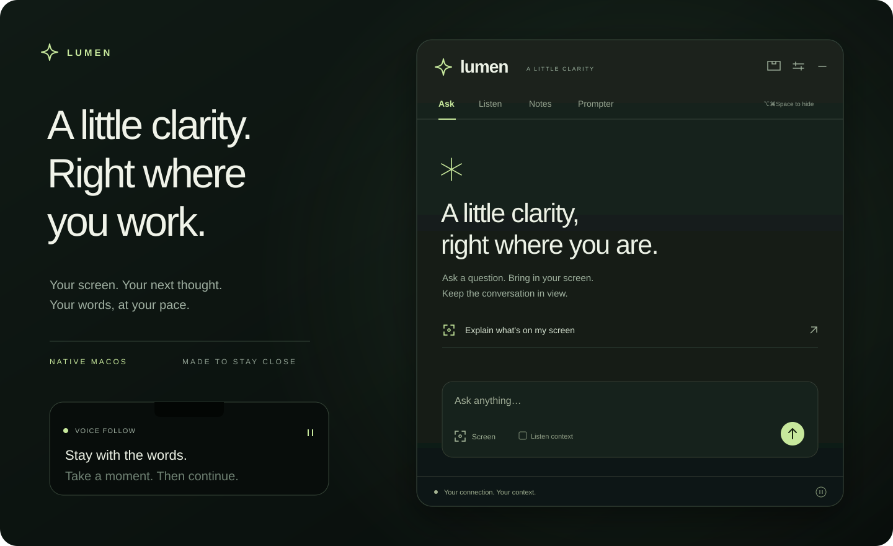

<div align="center">

# Lumen

### A little clarity, right where you work.

A native macOS assistant for screen context, conversations, and presentations.

[Get started](#get-started) · [Features](#made-for-the-moment) · [User guide](docs/guide.md) · [Privacy](docs/privacy.md) · [Development](#development)

<br>



<sub>Interface illustration. Lumen runs as a floating panel or a compact notch companion.</sub>

<br>

**macOS 14+** &nbsp; / &nbsp; **Swift + SwiftUI** &nbsp; / &nbsp; **No third-party Swift dependencies**

</div>

## About this project

Lumen is a personal software project inspired by existing desktop assistants. The original concept is not mine; this repository explores an independent implementation in Swift and SwiftUI, combining screen context, conversations, local notes, and presentation tools.

## Made for the moment

Keep a question, a conversation, or the next line of your presentation close at hand.

| | What you can do |
| :--- | :--- |
| **Ask** | Stream answers, attach a screen, revisit a conversation, and bring in selected transcript context. |
| **See** | Explain the selected display with a shortcut. Start a minute-by-minute session for up to 60 screenshots. |
| **Listen** | Transcribe microphone or system audio with Apple's on-device speech recognition. Save completed sessions to local notes. |
| **Present** | Paste a script and follow your voice, or use timed scrolling. Pause, restart, and adjust the reading size. |
| **Keep** | Search, tag, favorite, and archive notes. Export Markdown or PDF. Preview summaries before applying them. |
| **Make it yours** | Switch between a floating window and notch mode. Adjust transparency, change shortcuts, and toggle mouse click-through. |

## Get started

Lumen is currently distributed as source. Build it on the Mac where you plan to use it.

**You need:** macOS 14 or later and an Xcode Swift toolchain compatible with Swift 5.9 packages. For ChatGPT sign-in, install the Codex desktop app, a compatible ChatGPT desktop app, or the Codex CLI.

```sh
git clone https://github.com/Ahmed-gh-37/lumen.git
cd lumen
bash scripts/package-app.sh
open build/Lumen.app
```

1. Open **Settings → ChatGPT → Continue with ChatGPT** and finish signing in in your browser.
2. Return to Lumen. The connection updates automatically; **Check connection** is available too.
3. Ask a question, or choose **Explain what's on my screen**. Grant screen access when macOS requests it.

Lumen lives in the menu bar. Use its menu to reopen the panel, return from click-through mode, or quit.

### Choose your connection

| Connection | Sign-in | Usage |
| :--- | :--- | :--- |
| **ChatGPT** | Your ChatGPT account through the local Codex app-server | Uses your account's eligible plan allowance; no OpenAI API key. |
| **Google Gemini** | Your own Gemini API key | Billed separately by Google. |
| **Claude** | Your own Claude API key | Billed separately by Anthropic. |

ChatGPT uses a separate Lumen sign-in profile. It does not import your ChatGPT history, memories, or existing Codex settings. Available models depend on the connected account and installed helper. Gemini and Claude model IDs are editable in Settings. See [connections and permissions](docs/guide.md#connections).

## At your fingertips

Every shortcut can be changed or removed in **Settings → Shortcuts**. These are the defaults:

| Action | Shortcut |
| :--- | :--- |
| Show / hide | ⌥⌘Space |
| Explain my screen | ⌥⌘E |
| Capture a screen attachment | ⌥⌘S |
| Toggle mouse click-through | ⌘L |
| Start / stop automatic screen explanations | ⌘B |
| Teleprompter play / pause | ⌥⌘T |
| Ask / Listen / Notes | ⌥⌘A / ⌥⌘L / ⌥⌘N |

**Notch mode** expands on hover and stays open while the teleprompter runs. Choose its width and 2–8 reading lines. A general toggle returns to the floating window; automatic switching when playback starts is optional.

**Voice follow** advances when nearby spoken words match your script. Silence and unrelated speech do not advance it. Recognition can lag or mishear, and matching words from another speaker can move the script. Timed mode needs no microphone.

**Automatic screen explanations** send immediately, then attempt one capture each minute. Busy minutes are skipped; responses never overlap. The session stops at 60 successful sends, on an error, when paused or disconnected, or when Lumen quits. It never resumes automatically on launch.

## Your data, on your Mac

Notes, chat text, scripts, and preferences are saved locally. Optional API keys use macOS Keychain. Screenshots and raw audio are not saved to the workspace. AI requests transmit the text, context, and images used for that request to the chosen provider.

Capture exclusion is a request to macOS, **not a guarantee that the overlay will disappear from screen recordings or meetings**. Check with the sharing app you use. Lumen remains a normal visible process in Activity Monitor.

Read the [data and privacy guide](docs/privacy.md) for storage locations, permissions, and deletion.

## Development

The app and its core library are separate SwiftPM targets. Window management, capture, and views live in `Lumen`; persistence, provider clients, scheduling, and script matching live in `LumenCore`.

```text
Sources/
  Lumen/          App lifecycle, capture, state, and feature views
    Views/        Ask, Listen, Notes, Settings, notch, and teleprompter
  LumenCore/      Models, persistence, providers, and core behavior
Tests/
  LumenCoreTests/ Persistence, streaming, shortcuts, scheduling, and script matching
scripts/          App packaging and an isolated protocol test fixture
```

```sh
swift test --cache-path .build/cache --config-path .build/config --security-path .build/security
bash scripts/package-app.sh
```

Tests cover core behavior and provider protocols using fixtures. An installed Codex helper also gets an unauthenticated compatibility check; it is skipped when the helper is absent. Tests do not send authenticated AI requests or establish microphone accuracy or capture exclusion in third-party apps.

Packaging builds for the host architecture and uses an available signing certificate, with an ad-hoc fallback. It does not notarize, install, or publish the app. A stable signing identity helps macOS retain permission grants between builds. See [building and signing](docs/guide.md#building-and-signing).

For a change, keep the affected feature small, run the tests, and package the app. Use the checked-in formatting configuration:

```sh
swift format format --in-place --recursive Sources Tests Package.swift
```

Lumen is an independent application and is not affiliated with OpenAI, Google, Anthropic, or Apple.
